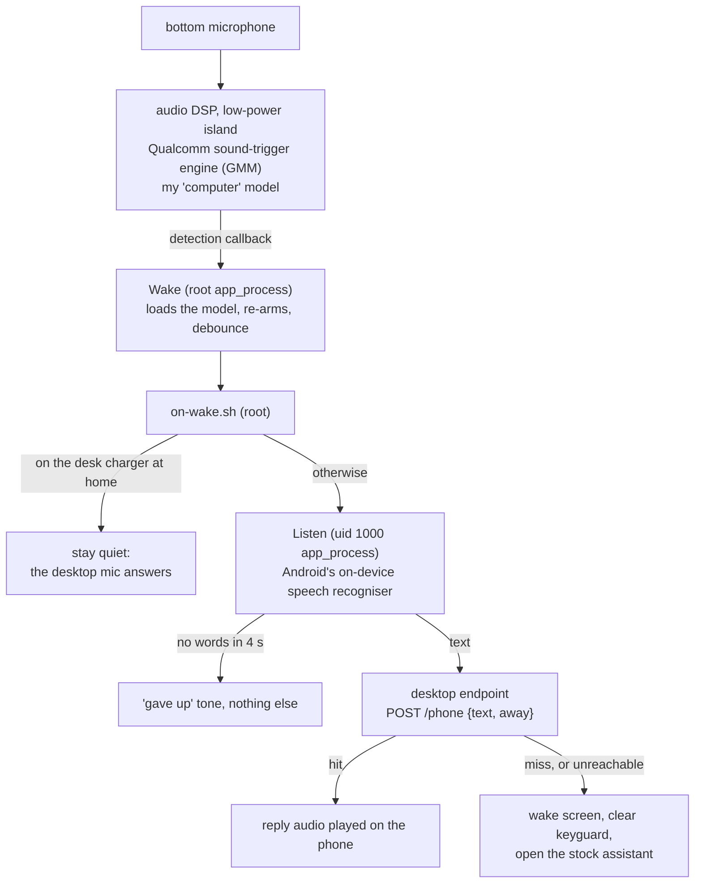

# android-dsp-wakeword

A custom "computer" wake word that runs on a phone's Snapdragon audio DSP with the screen off, driven from a root shell process with no app installed, and hands what you say next to your own desktop voice assistant.

> **Status: work in progress.** It runs on my own phone every day and still changes. It has been tested on exactly one phone model; on anything else, expect to adapt it.

> **Disclaimer.** This needs a rooted phone. It loads sound models straight into the audio DSP's sound-trigger engine, and the wrong model or setting **can crash the audio DSP**: on my phone that took out audio, the microphone and some sensors until a reboot. Use it at your own risk. This project is not affiliated with, endorsed by or supported by Amazon, Qualcomm or Google. No Amazon, Qualcomm or Google files are included.

## Why I built it

I already say "computer" to a voice assistant at my desk. I wanted the same word on my phone, with the screen off, without Google's assistant, and without an app keeping the main processor awake to listen all day. Phones already have a low-power audio chip that listens for a wake word while the rest of the phone sleeps, so I wanted my own word on that chip. On my phone "Hey Google" didn't even work with the screen off: Google's app never loaded a model onto the DSP.

The way in was an old Alexa wake-word model from an older version of Qualcomm's voice app. Once that ran on the low-power chip, I used the same Qualcomm toolchain to build a model of my own word from recordings of my own voice.

## How it works



**1. The wake word on the DSP** (`phone/src/Wake.java`, `phone/src/Codec.java`). Android has a hidden `SoundTrigger` API that apps with system permissions use to load wake-word models into the sound-trigger hardware. A root `app_process` can call it through reflection: `attachModuleAsOriginator`, `loadSoundModel` with Qualcomm's vendor uuid, `startRecognition` with an opaque config block (confidence levels plus a history-buffer setting), then wait for `onRecognition` callbacks and re-arm after each one. The model bytes go through Qualcomm Voice Activation's own codec class first, so its apk is put on the `CLASSPATH` and its native libraries are loaded from a folder. No app is installed and nothing under `/system` or `/vendor` is changed. The DSP does the listening; the main processor sleeps until a detection.

**2. The supervisor** (`phone/stwaked.sh`). Started at boot by a KernelSU or Magisk `service.d` hook. It runs `Wake`, restarts it with backoff, and watches the kernel's count of audio DSP fatal errors. If that count goes up while a model is loaded, it unloads the model and waits 30 minutes, so a bad model can't keep the phone in a crash loop. It holds no wakelock.

**3. After the wake** (`phone/on-wake.sh`, `phone/src/Listen.java`). On a detection, `on-wake.sh`:
- checks whether the phone is sitting on my desk charger (home Wi-Fi access point plus a magnet reading from `phone/native/magread.c`); if so it stays quiet, because the desktop's own mic will answer;
- pokes a resident listener through a FIFO. The listener uses Android's on-device speech recogniser (streaming, with its own end-of-speech detection), plays a chirp when the mic opens, and sends the text to a desktop endpoint;
- on a hit, the desktop sends back its spoken reply as a WAV and the phone plays it;
- on a miss (the desktop had nothing, or couldn't be reached), it wakes the screen, dismisses the keyguard and presses the assist key, which opens the stock assistant (Gemini on my phone). I then repeat myself there.

The desktop endpoint is a small JSON-over-HTTP contract (documented in `desk/desk_stub.py`). In my setup it is my desktop voice assistant's router, so the phone and the desk share one set of commands. The stub in this repo answers two test phrases.

### The tricks that made it work

- **Use the GMM engine, not PDK.** Qualcomm's DSP firmware here has two first-stage engines. Every PDK model (the kind QVA 6.x ships) crashed the ADSP in true low-power mode on my phone. The GMM engine, which older QVA versions and user-defined keywords use, runs cleanly in the stock screen-off config. Full trial log: [docs/dsp-trials.md](docs/dsp-trials.md).
- **Build your own keyword with Qualcomm's own library.** `libqvasml.so` (part of Qualcomm Voice Activation) exports `getUserDefinedKeywordSize` and `createUserDefinedKeywordModel`. `phone/native/udkgen.c` `dlopen`s it and calls them with your recordings and a UDK language model file (`default.lm`). The result loads on the DSP exactly like the Alexa model did. The language model was the missing piece: my phone doesn't have one, and newer QVA versions don't ship it.
- **How you cut the recordings matters.** Raw cuts and noise-gated cuts both made the library return status 14 ("no signal"). What worked: about 2.1 s around each word, not gated, peak-normalised to half scale, with 0.5 s of digital silence on each side (`tools/cut_clips.py`). And record from where you normally stand, not close up.
- **The speech recogniser needs uid 1000.** `SpeechRecognizer.createOnDeviceSpeechRecognizer` with the system context (`ActivityThread.systemMain().getSystemContext()`) fails as root with `SecurityException: Cannot register attribution source for package:android from uid:0`. Run the same `app_process` as the system user instead: `su 1000 -c "CLASSPATH=... app_process /system/bin Listen"`. Then it works, ready in about 0.1 to 0.5 s.
- **Some framework APIs don't work from `app_process` at all.** `new TextToSpeech(...)` gets the process SIGKILLed at the constructor, as root or uid 1000 (it binds a service directly, and the process isn't an attached app). The recogniser works because it goes through a system manager service. So the reply is rendered on the desktop and played with `AudioTrack`. `AudioTrack`, `ToneGenerator` and `Vibrator` all work.
- **Play on `USAGE_MEDIA`.** `USAGE_ASSISTANT` has its own volume group that the volume buttons never change, so the cues stayed loud with the volume turned down.
- **Give up on words, not on the recogniser's speech flag.** In a car or with the TV on, the recogniser keeps "hearing speech" until its cap. The listener cancels if no partial words arrive in 4 s.
- **Calibrate the bar by counting fires, not by looking at scores.** The engine fires as soon as the score crosses the bar, so a noise fire always reports a confidence equal to the bar. A histogram at a low bar tells you nothing. Count fires per 90 s of normal room sound at each bar instead.

## Measured results

All on my phone, my voice, 2026. Small samples, stated as counts.

| what | result | n, window |
|---|---|---|
| PDK models, true low-power mode | ADSP crash every time | 5 crashing trials (t1, t2, t4, t12, t14), Sep 30 |
| GMM "Alexa" model, true low-power mode | 3 detections from 3 times said, 0 crashes | n=3, Sep 30 (t15) |
| UDK model from 5 close-up clips: false fires per 90 s of room sound | bar 40: 24, bar 50: 7, bar 60: 1, bar 70: 0 | one 90 s window per bar, Oct 1 |
| same model at bar 70 | caught me 2 of 5 times (two runs); 0 false fires overnight | n=5 per run; ~6 h, Oct 1 |
| UDK model from 10 clips said from my normal spot, bar 70 | 5 of 5 (scores 70 to 73) | n=5, Oct 1 |
| first morning live with that model | off the charger: 17 fires from 18 times said (the 1 miss had the bottom mic facing away); on the charger: 1 of 1 correctly skipped. 0 fires without the word | n=19, Oct 1 06:43 to 09:20 |
| desk-charger gate (magnet reading) | docked 88 to 93 µT, loose about 49 µT | ~96 readings, one dock/undock cycle, Oct 1 |
| unexplained ADSP crash on a UDK model | 1, about 6 h into the first overnight run; the guard unloaded and restarted it | Oct 1 |
| listener: poke to mic open (warm, after the dock check) | about 0.11 to 0.14 s | 12 wakes in a car plus home tests, Oct 3 |
| "how's the car" at home: end of my speech to reply playing | 1.9 s | n=1, Oct 3 |
| unknown command: to the stock assistant opening | 0.42 s | n=1, Oct 3 |
| silence after the wake word: to the "gave up" tone | 4.0 s | n=1, Oct 4 |
| over LTE and a VPN, text round trip to the desktop | hit 1.45 s, miss 0.46 s | n=1 each, Oct 3 |

Known limits:

- **It also fires when I say "computer" in normal conversation.** The 11 away-from-home fires in the first morning were all that.
- **One microphone.** The DSP path uses only the bottom mic on my phone. Facing it away from me caused the one miss.
- **Battery drain is not measured yet.** The point of the DSP is near-zero idle cost, but I have not compared a day on against a day off.
- **A 12-wake test in a moving car went badly:** 6 were road noise that ran to the old 9 s cap (before the 4 s no-words rule), 5 were conversation that came back as misses. My test phrases did not come through cleanly there.
- At home, a one-breath "computer, do X" loses X: the dock check takes about 0.5 s before the mic opens.

## What you need to supply yourself

None of this is in the repo. Some of it is proprietary and some of it is specific to your phone.

| what | why | where I got it |
|---|---|---|
| A rooted Qualcomm phone whose audio HAL has SVA | the whole method | Mine is a RedMagic NX809J (Snapdragon, Android 16, KernelSU). Check `/vendor/etc/audio/*/resourcemanager*.xml` for a `QC_VOICE_UI` stream. Your path, sound card name and profiles will differ. |
| Qualcomm Voice Activation's apk and native libraries (`libqvasml.so`, `libqvajni.so`, and the `libqvapdk*`/`libqvauv` it loads with them) | the model codec and the UDK builder | On my phone: `/system_ext/priv-app/QualcommVoiceActivation/` (version 6.1.4). Copy the libs from your own phone into `/data/local/tmp/stwake/lib`. The supervisor puts the apk on the `CLASSPATH` from that same system path. |
| A UDK language model, `default.lm` (starts with the bytes `LMFORUDK`) | `udkgen` can't build a keyword without it | Not on my phone, and not in current QVA versions. Older QVA versions shipped one, and some phones carry one in `odm/etc/`. The copy that worked for me is 2,913,234 bytes, sha256 starting `6444e99f 5442ce5e`. |
| Optional: a GMM `.uim` model to prove the engine first | a known positive before you train anything | Qualcomm Voice Activation 4.3.2 (versionCode 403002) contains `a977b1c7_en-US.uim` ("Alexa"). |
| Ten recordings of your wake word | the model is trained on your voice | One take on the phone's recorder app, see "Train your word" below. |
| JDK 17+, Android SDK (build-tools, a platform jar), Android NDK | building | Android Studio's SDK manager or the command-line tools. |
| A desktop endpoint the phone can reach, and a shared token | where commands go | `desk/desk_stub.py` to start with. Same Wi-Fi, or your own VPN when away. |

## Install

You need to be comfortable with `adb`/`ssh`, `su` and a terminal. I deploy over `ssh` to Termux's `sshd` on the phone, but `adb push` plus `adb shell su` works the same way.

1. **Build on your computer.**
   ```sh
   phone/build.sh                 # -> phone/out/stwake.jar
   phone/native/build-native.sh   # -> phone/native/udkgen, phone/native/magread
   ```
2. **Put the Qualcomm pieces on the phone** (as root): `mkdir -p /data/local/tmp/stwake/lib`, copy the QVA libraries into `lib/`, and `default.lm` into `/data/local/tmp/stwake/`.
3. **Check what else holds the mic** before the first load: `dumpsys media.audio_policy | grep -A3 "AudioRecord Clients"`.
4. **Prove the engine with a guarded trial before anything runs unattended.** `phone/test.sh` loads a model, watches the DSP crash counter, unloads on the first crash, and **reboots the phone** if crashes continue after the unload. For example, with the optional Alexa model, 120 s:
   ```sh
   sh /data/local/tmp/stwake/test.sh t1 /data/local/tmp/stwake/a977b1c7_en-US.uim 40 true full 120 0
   ```
   Say the word a few times, then read `/data/local/tmp/stwake/test-t1.log` for `RECOGNITION` lines and the `RESULT:` line. **Never load a PDK model** (QVA 6.x presets) on a phone you can't afford to reboot.
5. **Train your word** (next section), then calibrate it.
6. **Configure:** copy `phone/stwake.conf.example` to `/data/local/tmp/stwake/stwake.conf` and set `MODEL` and `THR`. For the listener, write your endpoint URL to `/data/local/tmp/pv/desk.url` and the token to `/data/local/tmp/pv/voice.token`, both owned by uid 1000, mode 0600.
7. **Deploy:** `PHONE=<ssh host> phone/deploy.sh` copies the jar and scripts, installs the boot hook in `/data/adb/service.d/`, and starts the supervisor.

### Train your word

1. Mute anything else in the room that answers to the same word.
2. Record one take on the phone: the word 10 times, about 2 s apart, from your normal spot, with the phone where it normally lives.
3. Cut it: `tools/cut_clips.py REC_xxx.m4a clips/` (needs `ffmpeg` and `numpy`). Listen to the clips.
4. Push `phone/native/udkgen` and the `clips/` folder to `/data/local/tmp/stwake/`, then build on the phone (as root):
   ```sh
   cd /data/local/tmp/stwake && mkdir -p user
   LD_LIBRARY_PATH=lib ./udkgen lib/libqvasml.so default.lm computer user/computer.model clips/d01.raw clips/d02.raw ...
   ```
   Expect `status=0`, a model of about 1.5 MB and a matching score; mine were 88 to 93.
5. **Calibrate:** `touch /data/local/tmp/stwake/NOFIRE` (detections are logged as `WOULD FIRE`, nothing runs), set a bar in `stwake.conf`, `touch ABORT` to reload, and count fires per 90 s with the room normal (TV on, people talking). Raise the bar until that is 0. Then say the word 5 times, at least 5 s apart (there is a 4 s debounce). `rm NOFIRE` when you're happy.

## Running it

| what | how (on the phone, as root, in `/data/local/tmp/stwake`) |
|---|---|
| is it listening | `tail wake.log`: `STAGE listening`, then `RECOGNITION` / `FIRED` lines |
| what happened after a wake | `on-wake.log` (`fire`, `skip: docked`, `hit:`, `gemini`, `quiet:`) and `/data/local/tmp/pv/listen.log` |
| reload model or bar | edit `stwake.conf`, then `touch ABORT` |
| log only, no action | `touch NOFIRE` |
| run everything but never open the stock assistant | `touch NOGEMINI` |
| off | `touch DISABLED`, or delete `/data/adb/service.d/stwake.sh` |
| dry run of the listener without speaking | `echo "t1 text:what time is it" > /data/local/tmp/pv/run/poke`, then read `run/t1.json` |
| DSP crash count | `dmesg \| grep -c "remoteproc-adsp: fatal error"` (relative: the kernel log rolls over) |

## Layout

| path | what |
|---|---|
| `phone/src/Wake.java` | loads the model into the sound-trigger HAL as root, logs and re-arms on each detection, runs `on-wake.sh` |
| `phone/src/Codec.java` | wraps Qualcomm Voice Activation's own model codec |
| `phone/src/Listen.java` | resident uid-1000 listener: on-device recogniser, desktop request, reply playback, cues |
| `phone/stwaked.sh` | supervisor with the DSP crash guard |
| `phone/on-wake.sh` | after a detection: desk-charger gate, poke the listener, fall back to the stock assistant |
| `phone/test.sh` | one guarded trial: crash watchdog, auto-unload, auto-reboot |
| `phone/profile.sh` | experiments only: bind-mount an edited audio HAL XML to force another capture profile |
| `phone/native/udkgen.c` | builds a user-defined keyword model from your recordings with Qualcomm's library |
| `phone/native/magread.c` | one raw magnetometer reading (the desk-charger gate) |
| `phone/src/Probe.java`, `Attach.java`, `Stt.java`, `Say.java`, `Rec.java` | the probes from the build: list modules, attach, recogniser test, the TextToSpeech dead end, a raw recorder |
| `tools/cut_clips.py` | one recording of N words → N clips in the format `udkgen` wants |
| `desk/desk_stub.py` | stand-in desktop endpoint, documents the request/response contract |
| `docs/dsp-trials.md` | every trial: what crashed the DSP and what worked |

## What is not in this repo

Qualcomm's apk, libraries, firmware and sound models; the UDK language model; Amazon's Alexa model; my own trained model and recordings (they are my voice); my desktop voice assistant (only the endpoint contract and a stub); the cue sounds I use. The proprietary files are not mine to share, and the rest is personal or specific to my home. The table above says where each piece comes from.

## Built with Claude Code

I built this with Claude Code: it did the reverse engineering, the guarded DSP trials and the code, while I said the word into the phone and decided what the phone should do. The trial log in `docs/` is condensed from that work.

## License

MIT. See [LICENSE](LICENSE).
