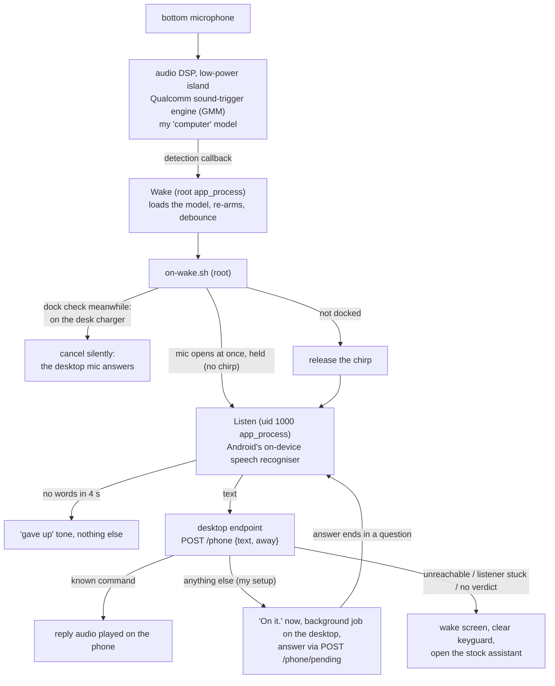

# android-dsp-wakeword

A custom "computer" wake word that runs on a phone's Snapdragon audio DSP with the screen off, driven from a root shell process with no app installed, and hands what you say next to your own desktop voice assistant.

> **Status: work in progress.** It runs on my own phone every day and still changes. It has been tested on exactly one phone model; on anything else, expect to adapt it.

> **Disclaimer.** This needs a rooted phone. It loads sound models straight into the audio DSP's sound-trigger engine, and the wrong model or setting **can crash the audio DSP**: on my phone that took out audio, the microphone and some sensors until a reboot. Use it at your own risk. This project is not affiliated with, endorsed by or supported by Amazon, Qualcomm or Google. No Amazon, Qualcomm or Google files are included.

## Why I built it

I already say "computer" to a voice assistant at my desk. I wanted the same word on my phone, with the screen off, without Google's assistant, and without an app keeping the main processor awake to listen all day. Phones already have a low-power audio chip that listens for a wake word while the rest of the phone sleeps, so I wanted my own word on that chip. On my phone "Hey Google" didn't even work with the screen off: Google's app never loaded a model onto the DSP.

The way in was an old Alexa wake-word model from an older version of Qualcomm's voice app. Once that ran on the low-power chip, I used the same Qualcomm toolchain to build a model of my own word from recordings of my own voice.

## How it works



**1. The wake word on the DSP** (`phone/src/Wake.java`, `phone/src/Codec.java`). Android has a hidden `SoundTrigger` API that apps with system permissions use to load wake-word models into the sound-trigger hardware. A root `app_process` can call it through reflection: `attachModuleAsOriginator`, `loadSoundModel` with Qualcomm's vendor uuid, `startRecognition` with an opaque config block (confidence levels plus a history-buffer setting), then wait for `onRecognition` callbacks and re-arm after each one. The model bytes go through Qualcomm Voice Activation's own codec class first, so its apk is put on the `CLASSPATH` and its native libraries are loaded from a folder. No app is installed and nothing under `/system` or `/vendor` is changed. The DSP does the listening; the main processor sleeps until a detection.

**2. The supervisor** (`phone/stwaked.sh`). Started at boot by a KernelSU or Magisk `service.d` hook. It runs `Wake`, restarts it with backoff, and watches the kernel's count of audio DSP fatal errors. If that count goes up while a model is loaded, it unloads the model and waits 30 minutes, so a bad model can't keep the phone in a crash loop. It holds no wakelock.

**3. After the wake** (`phone/on-wake.sh`, `phone/gate.sh`, `phone/src/Listen.java`). On a detection, `on-wake.sh` holds a 60 s kernel wakelock and:
- pokes a resident listener through a FIFO. The listener uses Android's on-device speech recogniser (streaming, with its own end-of-speech detection). At home the mic opens at once but **held**: no chirp yet;
- meanwhile checks whether the phone is sitting on my desk charger (home Wi-Fi access point plus a magnet reading from `phone/native/magread.c`). Docked: it cancels the listener silently, because the desktop's own mic will answer. Not docked: it releases the chirp. Because the mic was already open, a one-breath "computer, do X" keeps the X. A wake that isn't docked also turns the screen on, without unlocking, so you can see it heard you;
- the listener sends the text to a desktop endpoint. For a command the desktop knows, it sends back its spoken reply as a WAV and the phone plays it;
- in my setup, anything the desktop has no command for goes to a background Claude Code job on the desktop. The phone hears "On it." at once, then asks for the outcome (`POST /phone/pending`, held open until the job ends) and speaks the answer. If the answer ends in a question, the mic opens again for my reply, at most twice;
- only if the desktop can't be reached, the listener isn't reading, or no verdict comes back does it wake the screen, dismiss the keyguard and press the assist key, which opens the stock assistant (Gemini on my phone). With the stub in this repo, an unknown phrase is a "miss" and also goes there.

The desktop endpoint is a small JSON-over-HTTP contract (documented in `desk/desk_stub.py`). In my setup it is my desktop voice assistant's router, so the phone and the desk share one set of commands. The stub in this repo answers three test phrases, one of them through the slow "pending" path.

**4. Optional extras** (`phone/alertd.sh`, `phone/wgaway.sh`). See [Optional: desk alerts on the phone](#optional-desk-alerts-on-the-phone-when-its-off-the-dock) and [Optional: keep the VPN up off home Wi-Fi](#optional-keep-the-vpn-up-off-home-wi-fi).

### The tricks that made it work

- **Use the GMM engine, not PDK.** Qualcomm's DSP firmware here has two first-stage engines. Every PDK model (the kind QVA 6.x ships) crashed the ADSP in true low-power mode on my phone. The GMM engine, which older QVA versions and user-defined keywords use, runs cleanly in the stock screen-off config. Full trial log: [docs/dsp-trials.md](docs/dsp-trials.md).
- **Build your own keyword with Qualcomm's own library.** `libqvasml.so` (part of Qualcomm Voice Activation) exports `getUserDefinedKeywordSize` and `createUserDefinedKeywordModel`. `phone/native/udkgen.c` `dlopen`s it and calls them with your recordings and a UDK language model file (`default.lm`). The result loads on the DSP exactly like the Alexa model did. The language model was the missing piece: my phone doesn't have one, and newer QVA versions don't ship it.
- **How you cut the recordings matters.** Raw cuts and noise-gated cuts both made the library return status 14 ("no signal"). What worked: about 2.1 s around each word, not gated, peak-normalised to half scale, with 0.5 s of digital silence on each side (`tools/cut_clips.py`). And record from where you normally stand, not close up.
- **The speech recogniser needs uid 1000.** `SpeechRecognizer.createOnDeviceSpeechRecognizer` with the system context (`ActivityThread.systemMain().getSystemContext()`) fails as root with `SecurityException: Cannot register attribution source for package:android from uid:0`. Run the same `app_process` as the system user instead: `su 1000 -c "CLASSPATH=... app_process /system/bin Listen"`. Then it works, ready in about 0.1 to 0.5 s.
- **Some framework APIs don't work from `app_process` at all.** `new TextToSpeech(...)` gets the process SIGKILLed at the constructor, as root or uid 1000 (it binds a service directly, and the process isn't an attached app). The recogniser works because it goes through a system manager service. So the reply is rendered on the desktop and played with `AudioTrack`. `AudioTrack`, `ToneGenerator` and `Vibrator` all work.
- **Play on `USAGE_MEDIA`.** `USAGE_ASSISTANT` has its own volume group that the volume buttons never change, so the cues stayed loud with the volume turned down.
- **Give up on words, not on the recogniser's speech flag.** In a car or with the TV on, the recogniser keeps "hearing speech" until its cap. The listener cancels if no partial words arrive in 4 s.
- **Open the mic first, decide later.** The dock check takes about 0.5 s (the magnetometer starting up). Running it before the mic opened lost the X in a one-breath "computer, do X". Now the mic opens held, the check runs alongside, and the result either cancels the session silently or releases the chirp.
- **List the modules before you attach.** After a reboot the sound-trigger middleware refused every attach ("Client must call listModules() prior to attaching" in `dumpsys soundtrigger_middleware`) until some other app happened to list the modules. The word was dead for about half an hour after boot. `Wake` now calls `listModulesAsOriginator` itself first.
- **Never start the listener from an ssh shell.** Started from Termux's `sshd`, it lands in Termux's app cgroup, and Android's freezer stops it. `kill -0` still says it is alive, but nobody reads the FIFO. That cost me two days of every wake falling through to the stock assistant. It is now only started from a root process tree, and a poke that isn't read within 1 s restarts it once (`start_l` in `phone/gate.sh`).
- **A Wi-Fi blip is not "away".** The Wi-Fi scorer sometimes drops a full-signal home link for 1 to 3 s. A wake inside one of those went out as "away" from home. With `wgaway.sh` running, "home Wi-Fi within the last 15 s" still counts as home.
- **Calibrate the bar by counting fires, not by looking at scores.** The engine fires as soon as the score crosses the bar, so a noise fire always reports a confidence equal to the bar. A histogram at a low bar tells you nothing. Count fires per 90 s of normal room sound at each bar instead.

### The magnet lesson: the dock reading drifts

The desk-charger check reads the magnetometer and compares the field with the phone's own magnetism (`anom`, in µT). On day one that was clean: about 88 to 93 µT on the charger, about 49 µT loose. So I set the bar at 70.

It did not stay that way. `magread` subtracts the phone's **auto-calibration** bias, and the auto-calibration slowly learns the charger's magnet as part of "the phone's own field". The longer the phone sat on the charger, the lower the docked reading got: 98 to 105 µT on Oct 4, 80 to 85 on Oct 5, 74 to 87 on Oct 10, 68 to 72 on Oct 11. On Oct 11 docked readings were at or just under the bar of 70, and six desktop alerts in one morning played on the phone while it was on the charger. I dropped the bar to 64.

What I took from it:
- **A threshold on a sensor that calibrates itself is a moving target.** Re-measure after days, not minutes.
- **Don't re-derive a bar from rows the gate labelled itself.** A "loose" reading of 63 might really be a docked misread. The gate now logs a wireless-charging flag next to each reading, as ground truth that doesn't depend on its own decision. My charger turned out not to report as wireless charging, so for me that is still an open problem.
- **64 buys days, not a fix.** The real fix is to pin the bias: store it once with the phone well away from the charger and measure against that. That is not built yet.

## Measured results

All on my phone, my voice, 2026. Small samples, stated as counts.

| what | result | n, window |
|---|---|---|
| PDK models, true low-power mode | ADSP crash every time | 5 crashing trials (t1, t2, t4, t12, t14), Sep 30 |
| GMM "Alexa" model, true low-power mode | 3 detections from 3 times said, 0 crashes | n=3, Sep 30 (t15) |
| UDK model from 5 close-up clips: false fires per 90 s of room sound | bar 40: 24, bar 50: 7, bar 60: 1, bar 70: 0 | one 90 s window per bar, Oct 1 |
| same model at bar 70 | caught me 2 of 5 times (two runs); 0 false fires overnight | n=5 per run; ~6 h, Oct 1 |
| UDK model from 10 clips said from my normal spot, bar 70 | 5 of 5 (scores 70 to 73) | n=5, Oct 1 |
| desk-charger gate (magnet reading) | docked 88 to 93 µT, loose about 49 µT | ~96 readings, one dock/undock cycle, Oct 1 |
| same gate, re-measured | docked 82 to 85 µT, loose 25 to 61 µT; one more cycle read 31 to 61 "docked" (late or not seated, unknown) | 5 dock/undock cycles, 3 readings each: n=12 docked, n=15 loose, Oct 10 |
| same gate, after the drift | docked 68 to 69 µT checked by hand; 6 alerts played on the docked phone at 69 to 70 µT; bar 70 → 64 | n=3 hand checks + 6 gate readings, Oct 11 morning |
| unexplained ADSP crash on a UDK model | 1, about 6 h into the first overnight run; the guard unloaded and restarted it | Oct 1 |
| listener: poke to mic open (warm, after the dock check) | about 0.11 to 0.14 s | 12 wakes in a car plus home tests, Oct 3 |
| "how's the car" at home: end of my speech to reply playing | 1.9 s | n=1, Oct 3 |
| unknown command: to the stock assistant opening (before Oct 10, when unknown commands still went there) | 0.42 s | n=1, Oct 3 |
| silence after the wake word: to the "gave up" tone | 4.0 s | n=1, Oct 4 |
| over LTE and a VPN, text round trip to the desktop | hit 1.45 s, miss 0.46 s | n=1 each, Oct 3 |

Known limits:

- **It also fires when I say "computer" in normal conversation.** On the first morning, all the fires away from home were that.
- **One microphone.** The DSP path uses only the bottom mic on my phone. Facing it away from me caused the one miss.
- **Battery drain is not measured yet.** The point of the DSP is near-zero idle cost, but I have not compared a day on against a day off. The optional `alertd.sh` adds one wake-up per long poll (my desktop holds each poll for 240 s).
- **A 12-wake test in a moving car went badly:** 6 were road noise that ran to the old 9 s cap (before the 4 s no-words rule), 5 were conversation that came back as misses. My test phrases did not come through cleanly there.
- **The dock check drifts** (see the magnet lesson above). The bar of 64 is a stopgap.
- One-breath "computer, do X" at home was fixed on Oct 6 (the mic opens before the dock check). It is live on my phone, but I have not run a spoken test of it yet.

## What you need to supply yourself

None of this is in the repo. Some of it is proprietary and some of it is specific to your phone.

| what | why | where I got it |
|---|---|---|
| A rooted Qualcomm phone whose audio HAL has SVA | the whole method | Mine is a RedMagic NX809J (Snapdragon, Android 16, KernelSU). Check `/vendor/etc/audio/*/resourcemanager*.xml` for a `QC_VOICE_UI` stream. Your path, sound card name and profiles will differ. |
| Qualcomm Voice Activation's apk and native libraries (`libqvasml.so`, `libqvajni.so`, and the `libqvapdk*`/`libqvauv` it loads with them) | the model codec and the UDK builder | On my phone: `/system_ext/priv-app/QualcommVoiceActivation/` (version 6.1.4). Copy the libs from your own phone into `/data/local/tmp/stwake/lib`. The supervisor puts the apk on the `CLASSPATH` from that same system path. |
| A UDK language model, `default.lm` (starts with the bytes `LMFORUDK`) | `udkgen` can't build a keyword without it | Not on my phone, and not in current QVA versions. Older QVA versions shipped one, and some phones carry one in `odm/etc/`. The copy that worked for me is 2,913,234 bytes, sha256 starting `6444e99f 5442ce5e`. |
| Optional: a GMM `.uim` model to prove the engine first | a known positive before you train anything | Qualcomm Voice Activation 4.3.2 (versionCode 403002) contains `a977b1c7_en-US.uim` ("Alexa"). |
| Ten recordings of your wake word | the model is trained on your voice | One take on the phone's recorder app, see "Train your word" below. |
| JDK 17+, Android SDK (build-tools, a platform jar), Android NDK | building | Android Studio's SDK manager or the command-line tools. |
| A desktop endpoint the phone can reach, and a shared token | where commands go | `desk/desk_stub.py` to start with. Same Wi-Fi, or your own VPN when away. |

## Install

You need to be comfortable with `adb`/`ssh`, `su` and a terminal. I deploy over `ssh` to Termux's `sshd` on the phone, but `adb push` plus `adb shell su` works the same way.

1. **Build on your computer.**
   ```sh
   phone/build.sh                 # -> phone/out/stwake.jar
   phone/native/build-native.sh   # -> phone/native/udkgen, phone/native/magread
   ```
2. **Put the Qualcomm pieces on the phone** (as root): `mkdir -p /data/local/tmp/stwake/lib`, copy the QVA libraries into `lib/`, and `default.lm` into `/data/local/tmp/stwake/`.
3. **Check what else holds the mic** before the first load: `dumpsys media.audio_policy | grep -A3 "AudioRecord Clients"`.
4. **Prove the engine with a guarded trial before anything runs unattended.** `phone/test.sh` loads a model, watches the DSP crash counter, unloads on the first crash, and **reboots the phone** if crashes continue after the unload. For example, with the optional Alexa model, 120 s:
   ```sh
   sh /data/local/tmp/stwake/test.sh t1 /data/local/tmp/stwake/a977b1c7_en-US.uim 40 true full 120 0
   ```
   Say the word a few times, then read `/data/local/tmp/stwake/test-t1.log` for `RECOGNITION` lines and the `RESULT:` line. **Never load a PDK model** (QVA 6.x presets) on a phone you can't afford to reboot.
5. **Train your word** (next section), then calibrate it.
6. **Configure:** copy `phone/stwake.conf.example` to `/data/local/tmp/stwake/stwake.conf` and set `MODEL` and `THR`. If you want the desk-charger gate, also set `HOME_BSSID_RE` and measure `DOCK_ANOM` with `./magread 20` on and off the charger. For the listener, write your endpoint URL to `/data/local/tmp/pv/desk.url` and the token to `/data/local/tmp/pv/voice.token`, both owned by uid 1000, mode 0600.
7. **Deploy:** `PHONE=<ssh host> phone/deploy.sh` copies the jar and scripts, installs the boot hook in `/data/adb/service.d/`, and starts the supervisor. It also copies and starts the two optional loops below; delete `alertd.sh` and `wgaway.sh` from its two file lists if you don't want them.

### Train your word

1. Mute anything else in the room that answers to the same word.
2. Record one take on the phone: the word 10 times, about 2 s apart, from your normal spot, with the phone where it normally lives.
3. Cut it: `tools/cut_clips.py REC_xxx.m4a clips/` (needs `ffmpeg` and `numpy`). Listen to the clips.
4. Push `phone/native/udkgen` and the `clips/` folder to `/data/local/tmp/stwake/`, then build on the phone (as root):
   ```sh
   cd /data/local/tmp/stwake && mkdir -p user
   LD_LIBRARY_PATH=lib ./udkgen lib/libqvasml.so default.lm computer user/computer.model clips/d01.raw clips/d02.raw ...
   ```
   Expect `status=0`, a model of about 1.5 MB and a matching score; mine were 88 to 93.
5. **Calibrate:** `touch /data/local/tmp/stwake/NOFIRE` (detections are logged as `WOULD FIRE`, nothing runs), set a bar in `stwake.conf`, `touch ABORT` to reload, and count fires per 90 s with the room normal (TV on, people talking). Raise the bar until that is 0. Then say the word 5 times, at least 5 s apart (there is a 4 s debounce). `rm NOFIRE` when you're happy.

## Optional: desk alerts on the phone when it's off the dock

My desktop speaks camera alerts in the room. `phone/alertd.sh` makes the phone speak them too whenever it is not on the desk charger, at home or away.

- The desktop usually can't reach the phone, so the phone asks: a root loop long-polls `POST <desk.url>/alerts`. The desktop answers with a WAV the moment an alert is queued, or 204 after a hold. The contract is in `desk/desk_stub.py`, which only ever answers 204.
- Each alert goes through the same dock check as the wake word (`phone/gate.sh`). Docked: dropped, the desk speaker has it. Loose or away: the listener chimes and plays it. It waits up to 15 s for an open mic to close first, so the recogniser never hears an alert as your words.
- The token goes to `curl` in a 0600 header file, never on the command line, because a process's command line shows up in `ps`.
- Off: `touch /data/local/tmp/stwake/ALERTD_OFF`. Log: `alertd.log`.

## Optional: keep the VPN up off home Wi-Fi

Away from home the phone reaches the desktop through my own WireGuard VPN. `phone/wgaway.sh` is a root loop that raises the tunnel whenever the phone is off the home Wi-Fi and drops it after 45 s back on it.

- Needs the official WireGuard app with a tunnel set up, and its "allow remote control apps" setting on. Set `HOME_SSID`, `WG_TUNNEL` and `WG_PHONE_IP` in `stwake.conf`. Use a split tunnel (only your home LAN and the VPN subnet) so only home traffic rides it.
- Up at once, down slowly: at the edge of the house a weak 2.4 GHz link drops to cell and comes back minutes later, again and again. A plain poll tracked every flap.
- On my ROM, two vendor blocks silently ignored the root broadcasts to WireGuard until they were lifted for it (a vendor auto-launch list and Android's background service-start ban). The script re-applies both at start; on another phone they are harmless no-ops or need your own equivalent.
- If a wake happens away with no tunnel, `on-wake.sh` raises it too. It is up in about 1 to 2 s, while you are still talking.
- Off: `touch /data/local/tmp/stwake/WGAWAY_OFF`. Log: `wgaway.log`.

## Running it

| what | how (on the phone, as root, in `/data/local/tmp/stwake`) |
|---|---|
| is it listening | `tail wake.log`: `STAGE listening`, then `RECOGNITION` / `FIRED` lines |
| what happened after a wake | `on-wake.log` (`fire`, `skip: docked`, `hit:`, `gemini`, `quiet:`) and `/data/local/tmp/pv/listen.log` |
| reload model or bar | edit `stwake.conf`, then `touch ABORT` |
| log only, no action | `touch NOFIRE` |
| run everything but never open the stock assistant | `touch NOGEMINI` |
| off | `touch DISABLED`, or delete `/data/adb/service.d/stwake.sh` |
| no screen wake on a fire | `touch NOSCREEN` |
| restart a stuck listener (after a code change, or it stopped answering) | `kill $(cat /data/local/tmp/pv/run/listen.pid)` and stop there: the next wake starts it again from root. Never start it by hand from an ssh shell (see the tricks). A listener that doesn't read a poke within 1 s is restarted once on its own. |
| dead after a reboot | `wake.log` shows `listModules rc=…` then `attached …`. If attach still returns null, read `dumpsys soundtrigger_middleware` for the reason; the supervisor keeps retrying with backoff. |
| desk alerts / VPN keeper | `alertd.log`, `wgaway.log`; off with `touch ALERTD_OFF` / `touch WGAWAY_OFF` |
| dry run of the listener without speaking | `echo "t1 text:what time is it" > /data/local/tmp/pv/run/poke`, then read `run/t1.json` |
| DSP crash count | `dmesg \| grep -c "remoteproc-adsp: fatal error"` (relative: the kernel log rolls over) |

## Layout

| path | what |
|---|---|
| `phone/src/Wake.java` | loads the model into the sound-trigger HAL as root, logs and re-arms on each detection, runs `on-wake.sh` |
| `phone/src/Codec.java` | wraps Qualcomm Voice Activation's own model codec |
| `phone/src/Listen.java` | resident uid-1000 listener: on-device recogniser, desktop request, reply playback, cues |
| `phone/stwaked.sh` | supervisor with the DSP crash guard |
| `phone/on-wake.sh` | after a detection: poke the listener (held at home), desk-charger gate, raise the VPN if away, fall back to the stock assistant |
| `phone/gate.sh` | shared by `on-wake.sh` and `alertd.sh`: the desk-charger gate and the listener start/restart/poke helpers |
| `phone/alertd.sh` | optional: desk alerts spoken on the phone when it is off the dock |
| `phone/wgaway.sh` | optional: keep the WireGuard tunnel up whenever the phone is off the home Wi-Fi |
| `phone/service.d-stwake.sh` | boot hook: starts the supervisor, plus the optional loops if they are on the phone |
| `phone/test.sh` | one guarded trial: crash watchdog, auto-unload, auto-reboot |
| `phone/profile.sh` | experiments only: bind-mount an edited audio HAL XML to force another capture profile |
| `phone/native/udkgen.c` | builds a user-defined keyword model from your recordings with Qualcomm's library |
| `phone/native/magread.c` | one raw magnetometer reading (the desk-charger gate) |
| `phone/src/Probe.java`, `Attach.java`, `Stt.java`, `Say.java`, `Rec.java` | the probes from the build: list modules, attach, recogniser test, the TextToSpeech dead end, a raw recorder |
| `tools/cut_clips.py` | one recording of N words → N clips in the format `udkgen` wants |
| `desk/desk_stub.py` | stand-in desktop endpoint, documents the request/response contract |
| `docs/dsp-trials.md` | every trial: what crashed the DSP and what worked |

## What is not in this repo

Qualcomm's apk, libraries, firmware and sound models; the UDK language model; Amazon's Alexa model; my own trained model and recordings (they are my voice); my desktop voice assistant and its Claude Code job runner (only the endpoint contract and a stub); the cue sounds I use; the screen and lock-screen art the phone shows on a wake, and the camera-app hookup for alerts (both specific to my phone and home). The proprietary files are not mine to share, and the rest is personal or specific to my home. The table above says where each piece comes from.

## Built with Claude Code

I built this with Claude Code. I set the goal, ran every live test with my own voice and phone, and decided how the phone should behave; Claude Code did most of the reverse engineering, ran the guarded DSP trials and wrote the code. The trial log in `docs/` is condensed from that work.

## License

MIT. See [LICENSE](LICENSE).
